# 10/27/2026 Started working on project + read docs!! (Arya: 1hr)

Arya: Today, I made a new EasyESA project and found a good ESP32 module and placed it! I decided to use the ESP32-S3 as it supported native USB-OTG and also was very powerful with 16MB of flash and 8MB of PSRAM! I then decided to do some research for the drone so I know what we should put for the schematic. It did take a while, but I figured out which firmware we are going to use, and I also found a good reference schematic to use. We decided to do the ESP-Drone firmware as it was made by Espressif themselves and in the official docs with an official app for controlling the drone. We also planned to use a MPU-6050 module instead of the bare chip since the modules were way cheaper compared to the bare chip. We did not get too much done with the project today, but it should be easier after we finish researching and understanding the parts that the drone will need since this is my (and possibly Funmi's) first time making a drone!

Lapse: https://lapse.hackclub.com/timelapse/IyVeEQJVIN3q

Funmi: We started a new project! We used references from online schematics of open sourced drones that used the esp32 and whatnot! Also used AIs help to ensure we got the right projetcs

I started by sourcing and adding components. WI added a USB-C port, pins for the mpu6050 gyro module, and a gnss module (gps system)!

Lapse: https://lapse.hackclub.com/timelapse/ATaTE4Z-aU6C

# 10/28/2026 Placed more parts on the schematic + completed motor circutry!! (Arya: 1hr)

Arya: Today, I put some more parts on the schematic! I did do a lot of research for what parts to put, and I did use some other part since I had some trouble with finding the parts from the reference schematic. But the parts have the same function the same way, so I just used the alternatives that I found. This primarily applied to the MOSFETs for the motors. I also did get stuck on how the wiring on the MOSFETs on the reference schematic worked, so I asked a friend in a Slack Huddle and he helped me understand. I used some AI to help me understand deeper and confirm on that since he was not sure of his response. I did have some trouble with finding the 1N4148W diodes for the motor circuitry since there were a LOT of different diodes called the same things with the exact same features on most of them, but some of them had different ratings. I think I am done with the motor circuitry component placement as of now!

Lapse: https://lapse.hackclub.com/timelapse/JW5rUNNi4N1H

Arya: Today, we completed placing the main components on the schematic and started some wiring as well! I started with finishing up the components by adding a thing for power regulation, and we decided to use a buck-boost converter instead of a LDO like the reference schematic used since we were using a battery and that the 3V3 components should not be under or overvolted as that may damage them. It was a bit tricky finding a good buck- boost module, but I managed to find a decent one from TI that had the proper voltage output and supported enough amps being drawn. I also added some capacitors and header pin footprints to the schematic for the motor wiring/circutry. I then also added a slide switch for the power so that we had a nice way for turning it on and off. I also did the wiring for the power switch as well!

Lapse: https://lapse.hackclub.com/timelapse/hAp201WeoFbX

Funmi: I sourced and added more components for our drone! I added a battery charger, and an arm/disarm button! while my teammate added a bulkboost! And then I began wiring the esp32! I wired the boot and enable pins, and also power on the esp32!

Lapse: https://lapse.hackclub.com/timelapse/Kp5qmIuY9EUv

# 10/30/2026 Finished the schematic!! (Arya: 1hr 25mins)

Arya: Today, we locked in and finished the schematic for the PCB! I worked on the motors, and I used the reference schematic to help me wire the parts together, and then I made some nets and connected them to each motor setup. I finished all of the wiring for the motor. We then worked on wiring other things, like the TP4056 charging IC for the battery and the MPU-6050 gyro module. I used the pinout of a module that I had with me to help me wire the module! It only needed 4 pins for the main things, the other 4 pins available on the module were left unconnected. We then connected everything else to the ESP32, and we are now done with the schematic for the drone! When we work on this next time, we may start with the PCB for the drone or another schmeatic!

Lapse: https://lapse.hackclub.com/timelapse/q_PGseIQKXhP

Funmi: Today, I wired up the USB-c port up to the esp32; I had actually added a daul core port, so I had to change the component I added, and then I wired it up! I also corrected the esp32 boot and reset pins wiring (I had it messed up in my head). and then I also wired the battery charger using the datasheet, and started wiring the buck boost!

Later in the evening, I finished wiring the buck boost! I used the official datasheet, and verified all the connections by searching them up. I then wired the battery charger. I made referrence to our previous work where we used a similar charger, as well as the datasheet and some searching up! I then connected decoupling capacitors to the nets of both the eps32 and the usb-c port. other components had decoups!

Lapses: https://lapse.hackclub.com/timelapse/9H1b02PIKix8
https://lapse.hackclub.com/timelapse/0EReSTvB6Si9

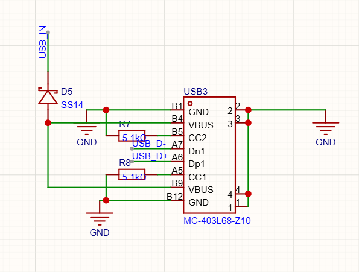

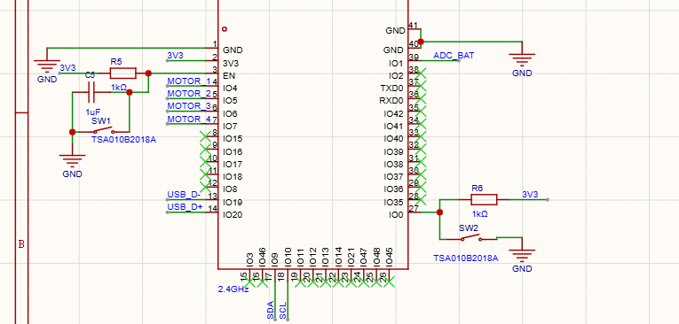

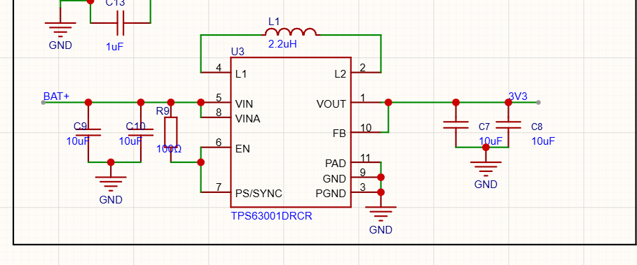

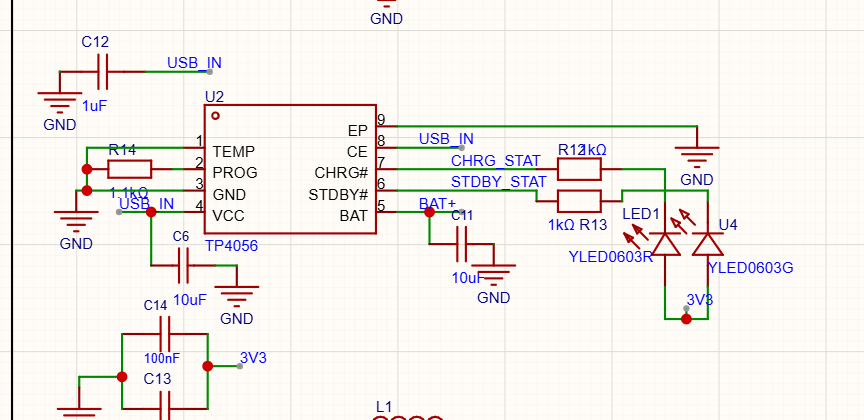

# 10/31/2026 Started and Finished PCB!! (Arya: 3hrs)

Arya: Today, we started and finished the PCB for the drone! We first started off with making some fixes to the schematic as we missed some things from last time, but we finally then moved on to the PCB. We started off with the layout of the PCB, and then we also decided the shape of the PCB as well, Funmi initially found a DXF and used that for the shape, but the center area turned out to be too small to comfortably fit the components and the thick power wires as they will carry a lot of current for the motors. Funmi then found a better DXF file that had a significantly larger center, so we decided to do that, and the components comfortably fit in to place with plenty of space for comfortable wiring. After we placed the components, we started with the wiring, by using the default trace width. But then, we decided that running 4 motors at once will draw plenty of power, so I converted the thin traces into larger and thicker traces so that they do not burn out. We then ran DRC and finished any wiring that was unconnected before doing the ground fill, which will connect all of the GND pins, and this is the main reason on why we did not wire any of the GND pins. We then connected the areas there the ground fill would not reach and then we changed the outline of the PCB so that the ESP32's antenna does not have any PCB under it as that is very bad for it and can strongly interfere. We are now done with the schematic and PCB for the actual drone, and now we decided to make a optional schematic and PCB for the remote so that there is another way to control it!

Lapse: https://lapse.hackclub.com/timelapse/CQgJdJIBf0Yd

Funmi: I got my teammate started on the PCB while I finished up the schematic! I used AI to generate an image so that we could convert that into a dxf to use for our board outlines! The first image I generated tho, didnt have enough space, so I had to make it more spacious even though it lost some (aerospace thingy.. when i remember the word, i'll write it).

After converitng that into a dxf, I imported it in easyeda to be the board outline! My teammate started placing the major components on it, w the motors on the egdes of the drone! When he had placed the major components, I placed most of the passive components and power components (buck boost and charger)! And then we started wiring! I did the differential pairs this time around, iirc, the difference was extremely tiny (i;m a pro ik)!

We finished wiring the entire pcb, ran drc, fixed our errorrs, and our pcb was done! IK I corrected some schem changes along the way!

We also made our power lines and wires to the motors to be much thicker because we know the motors are gonna draw a lot of power!

Lapse: https://lapse.hackclub.com/timelapse/UBv8r2Zs-w55
https://lapse.hackclub.com/timelapse/-6HV9QeK-hMO

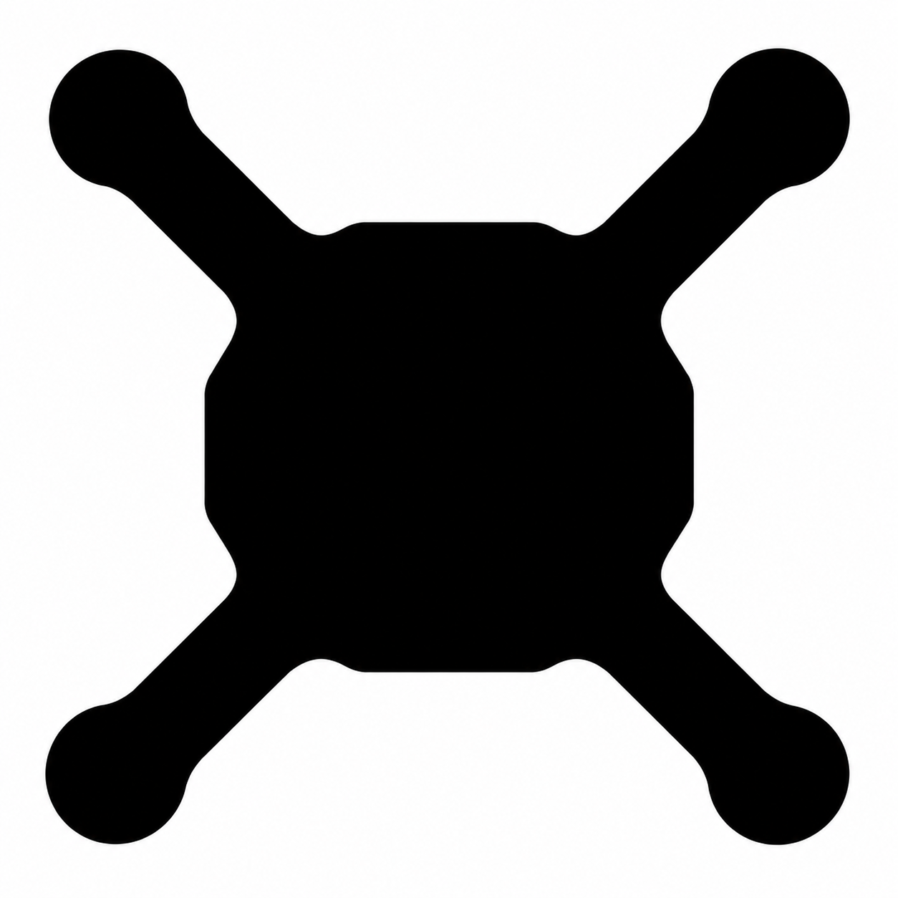

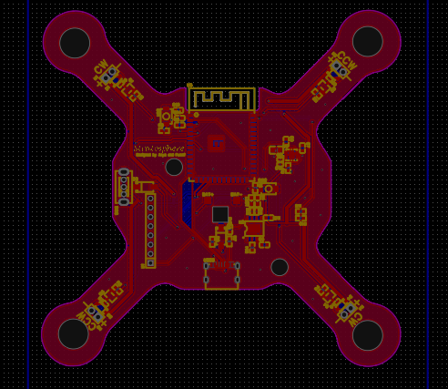

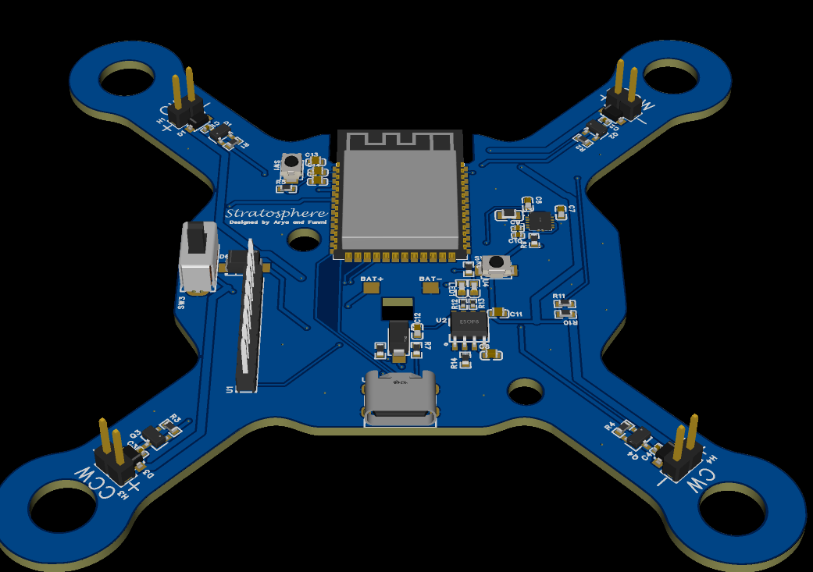

# 11/1/2026 Started and almost finished remote!! (Arya: 2hrs 40mins)

Arya: Today, we started with the remote that will go along with the drone! We managed to almost finish it! We decided to use ESP-NOW as the wireless communication protocol between the drone and the remote, and we used the same ESP32 chip as the drone for the remote as well! The remote will have two joysticks and will also be powered by a battery! We also imported some ICs like the battery charger and the buck-boost from the schematic of the main drone along with the power switch and the reverse protection diodes, and managed to finish the schematic! We then started with the PCB and used a DXF for the outline that was shaped like a game controller. We then layed out the things and started wiring! We did not finish all of the wiring, but we almost are done with it!

Lapse: https://lapse.hackclub.com/timelapse/f50ZKv_25U5I

Funmi: Today, we started working on a remote for our drone! I started by sourcing and adding some of the components tyhat our remote needed! I added a joystick, a switch for arm/disarming the PCB! I also added an esp32, an ldo and a battery charger, considering we were also tryna do a battery for our pcb! After sourcing these components, I started wiring them using their datasheets!

My teammate suggested adding a second joystick, which we did! I wired up the joystick which also had a switch push, and my teammate added a second (and also corrected some of my wiring on the joystick) based on the pinout on its page and with the help of AI, especially cuz the pinout wasn't explicitly stated (no documentation of the pinout on the datasheet). I added NC connectors to the edp32's unused pins, and ran drc for our full schematic!

Then we got started on the PCB. We decided to do a game controller shaped remote! So, again I generated another image and converted it into a dxf. I imported it as board outline leayer to our pcb! wHILE my teammate was placing some of the main components on the PCB, I added some ohter stuff like voltage checker for checking the battery, decoup caps, etc! Then,I joined my teammate to place all the other components on the PCB, ofc taking all the constraints into consideration!

I had to change the size of the pull up resistors for the usbc port to 0402s because there was limited space, and I wasn't gonna be able to wire the 0603s where we had them placed..! I managed to constrain space (especially around the port and esp32) and got everything there wired! We again made some of our lines thicker, especially for the power lines! We managed to finish wiring most of the pcb, run drc and fix some of our non-connected pins (non-gnd cuz we always do gnd fills). Just a few more things to wire from here, and we're shipping for this week! (know it's a long lapse, instead of syncing when i took a break, i just paused!)

Lapse: https://lapse.hackclub.com/timelapse/YJnJmcOCOAVL

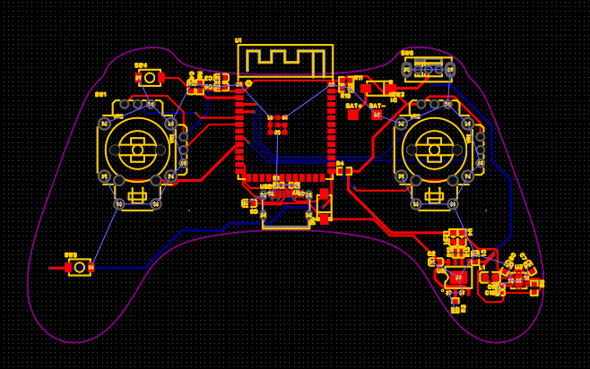

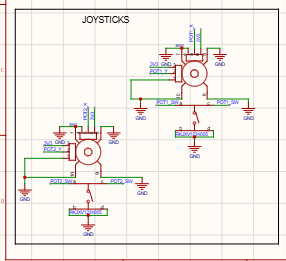

# 11/2/2026 Finished remote PCB + added motor holes to drone PCB and branded both PCBs + started CAD!! (Arya: 4hrs)

Arya: Today, I managed to finish up the PCB for the remote for the drone and also managed to add holes for the motors on the drone! I even branded both of the PCBs! I also managed to start the enclosure for the remote as well and make good progress! Starting off with the PCBs, I did DRC and confirmed all of the wiring except the GND, and then I did a ground fill on the PCB. I then connected the things that did not get connected via the ground fill together and I also added random vias between the two ground fill layers as it is good for the PCB. I then went on AliExpress to look for some motors that will work with our drone, and I found a good set that had 2 CW and 2 CCW motors and that was exactly what I needed! I added holes to the drone PCB for the motors and then moved on to the CAD for the remote! I did have a lot of trouble with getting the DXF of the outline of the remote PCB compatible so that I could use the offset tool in Onshape that makes the outline bigger on all sides evenly. After trying a lot of things, my only solution was to remove the antenna outline as that was the cause of the problem. But after that, the offset tool worked fine! I then manually added an antenna outline back by using the measuring tool in EasyEDA to get the proper dimensions of the antenna. I decided to make it a bit bigger than the dimensions so that the things would fit. I then extruded everything and added a hole for the charging port of the remote. It was a bit trick as Onshape would not let me make a sketch on the side of the case for some reason, so I had to make a hole from the top of the case, extrude it downwards, and then make another sketch that fills the area above the port back up. This was very tricky today. I then started with making the top part of the case by using the same sketch for the sketch on the top so that the dimensions would be perfect. I then added a circular hole to the top part for the joystick and aligned it properly. I still have to do the holes for the other joystick and other buttons! To help me get the proper placement of the holes and parts on the CAD, I made an assembly which I went back and forth with to help me align things properly!

Lapse: https://lapse.hackclub.com/timelapse/nyggARL979qf

# 11/3/2026 Finished CAD for remote + added mounting holes to PCB!! (Arya: 3hrs)

Arya: Today, I managed to finish the CAD for the remote for the drone and prepare for the cad for the drone by adding some mounting holes to the drone PCB! Starting off with the drone, I added another circular hole for the other joystick and properly aligned it! Going back and forth from the assembly to the part studio for the top part turned out to be very helpful as that showed me where exactly the components would be and helped me get a better alignment for the holes. I then added some holes for the buttons and the switch so that they could be accessible! And I then added two screw holes to the top and bottom part of the case so that they could be secured together. I made the holes 1.5mm in diameter, as there was not too much space. And I then fileted the edges of the remote so that it would be comfortable to hold and use. And this was everything that would be needed for the remote! I am now done. I then decided to make a lightweight enclosure for the drone PCB, and I did some research and then decided to add some mounting holes to the drone so that the case could easily be mounted to the drone with screws. I used 2.2mm diameter holes, which should fit M2 screws! I then exported the DXF to the Onshape document to get started with the outline and this is where I ended today. 

NOTE TO SELF: forgot to make the inside of the remote enclosure 1mm bigger everywhere so that the PCB would actually fit.

Lapse: https://lapse.hackclub.com/timelapse/La3krgGdeiRh

# 11/4/2026 Fixed CAD + fixed screw holes in drone PCB!! (Arya: 50mins)

Arya: I realized yesterday that I had messed up with the CAD for the remote as I did not add any space around the outline of the PCB so that the remote would fit! So, I started off today with fixing that! I first went back to the first sketch of the bottom part of the remote, and I had to manually select all of the lines in the inner sketch as I could not select any of the outer lines as that would mess things up. After I manually got each line, other than the antenna as that would be problematic with the offset tool, I used the offset tool to scale the whole thing up my 1mm as that would be enough space for the PCB to slide in. The extrudes than became weird and started popping up with errors when I fixed then, so I had to make a whole different extrude and everything so that everything would not mess up, this was a good workaround, but I wish that I realized it earlier so that I could have saved quite some time. I then had to reassemble the bottom part in the assembly as the bottom part showed errors as the design updated and then fixed the filet of the bottom screw hole in the top part of the case as I noticed that it was not rounded out. After fixing that, I moved on to the PCB for the drone and its CAD. I started off with looking at the screw holes and realized that there would be a bigger head of the screw and adjusted my design with it. A lot of time got taken by the fact that there should be about 2mm of space around it, so I did have to move some things around and rewire some things. And then when I thought I was done, I went to the Onshape document for the CAD for the drone and made a circle that was 2.2mm. It seemed way smaller than it should be, so I then checked online of a good hole size for the screw, and it was right. I then realized that the defined value for the circle when you draw it in Onshape is the diameter, and I went back to the PCB in EasyEDA to confirm that size for the hole, and then I realized that it was the radius instead of the diameter! I realized this when I was nearing the end of today's time, but I managed to get the holes in the proper position and size! 

Lapse: https://lapse.hackclub.com/timelapse/3lhUqVo5vYKt

# 11/5/2026 Fixed PCB wiring + got stuck on CAD!! (Arya: 1hr 30mins)

Arya: Today, I fixed some bad wiring on the PCB that someone pointed out and also attempted to get some CAD done! I was looking through the PCB while also being in a Slack huddle, and someone helped me fix some wiring for the PCB and make it be better! After I got some things fixed, I had trouble with the DXF exporting the screw holes from the PCB to the DXF as it would not show, so I decided that I will manually define their positions. But I was exporting a DXF again, while I saw the multi-layer option in the EasyEDA menu, I decided to try that, and the holes exported! The only downside was that other holes and the vias also exported so I had too manually go through and remove them!

Laspe: https://lapse.hackclub.com/timelapse/LJeRx3feAz_-

# 11/6/2026 Worked on CAD!! (Arya: 1hr)

Arya: Today, I got some more CAD done! I wanted to make the base as light as possible since more weight would not be good for the drone, and yet the drone will need to have a way for it to sit without the PCB being on the floor. I decided to make some lines that to across the DXF in multiple directions, and then I extruded the parts that were needed for the base to be connected to the other things! It turned into a x-like shape! I then assembled the base with the PCB just to confirm things! I then forgot about the screw holes that need to actually screw, so I extruded the screw holes and made a new hole using the hole tool in their place which would allow the screw to actually drill through and stay instead of slide through like the PCB! After doing that, I added some little feet that the drone could land on, keeping some distance from the ground and the drone! I made legs around the location of the motor holes in the base and the PCB!

Lapse: https://lapse.hackclub.com/timelapse/WVjIrPs2Qs_R

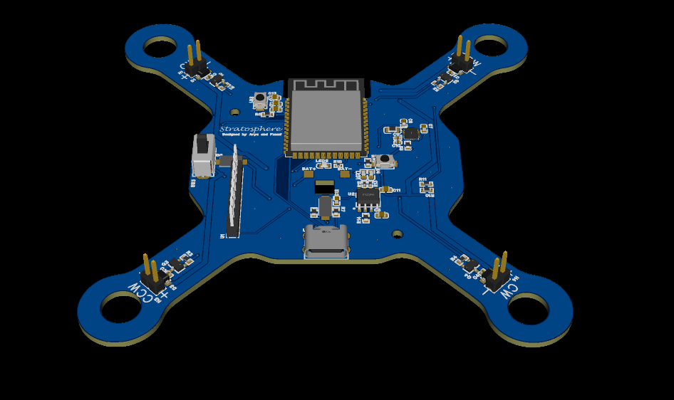

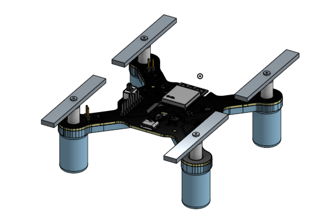

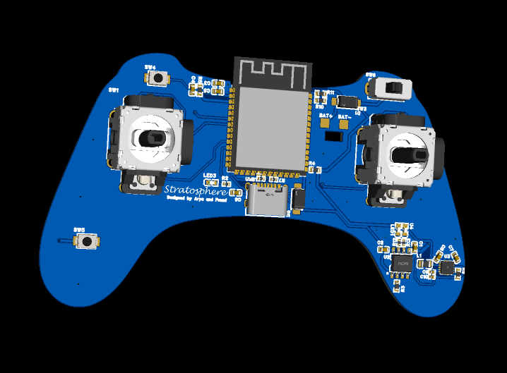

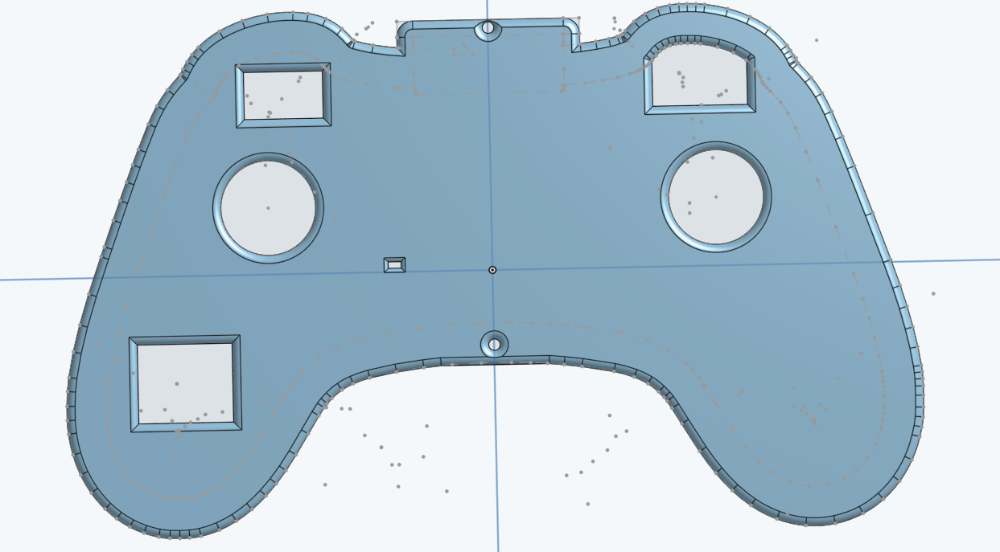
