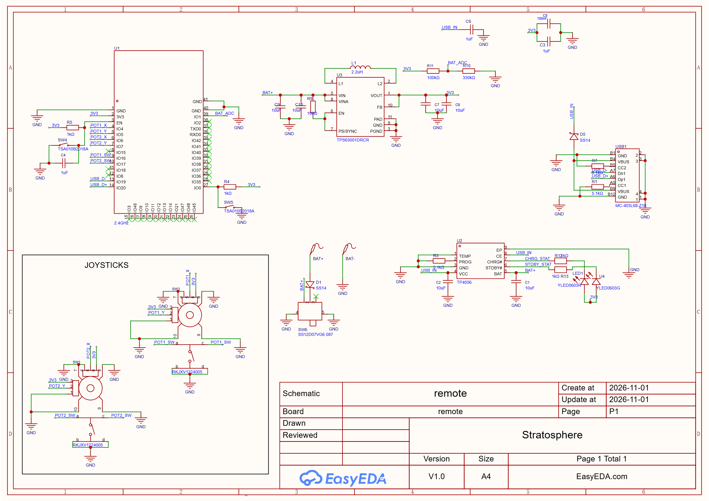
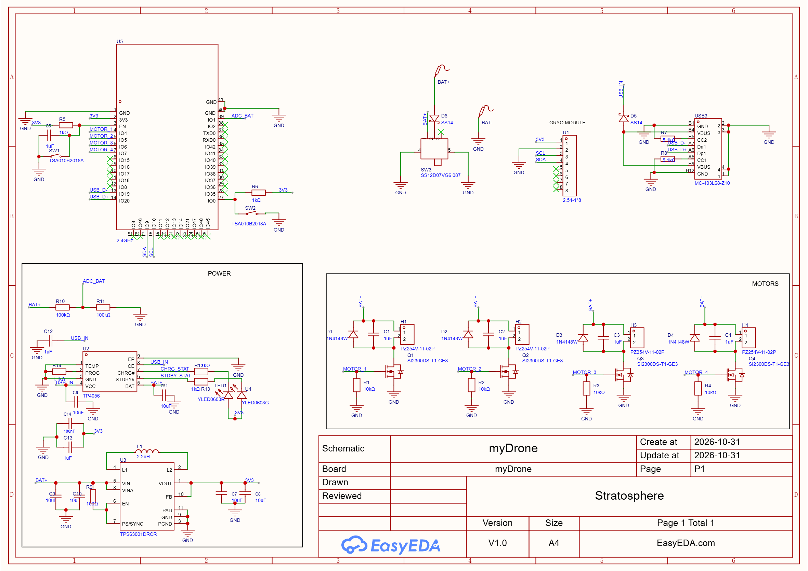
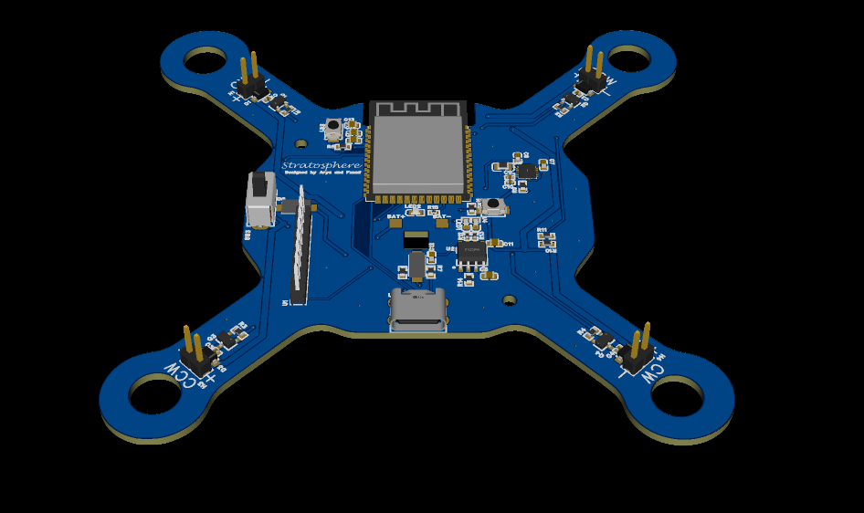
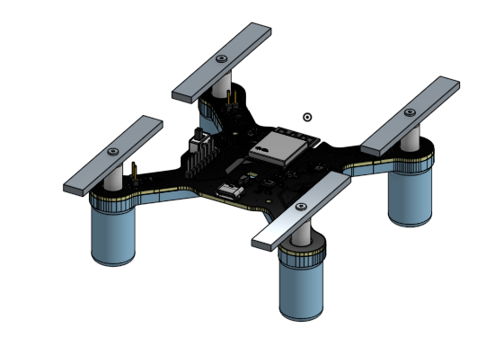
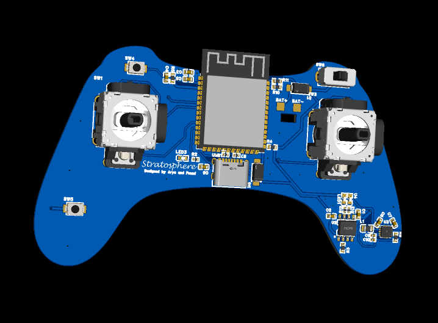
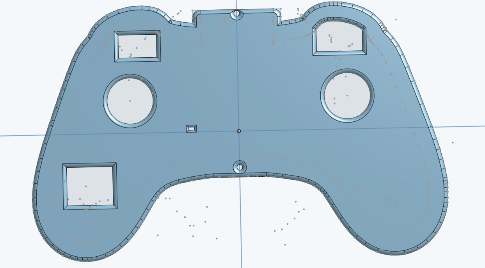

# Stratosphere

This is an esp32-powered drone, controlled by a remote!

# Key Features:

|Features|Model|
|-|-|
|Processor|ESP32-S3-WROOM-1-N16R8|
|Power Supply|Li-po Battery chargeable by USB-C|
|Communication/Data Transfer|ESP-now|
|LDO|TPS63020DSJR buck boost|
|Battery Charger|TP4056|
|Temperature + Humidity + Pressure sensor|BME280|
|Motors|4 brushed 720 motors|

# PICTURES OF SCHEMATIC, PCB AND CAD

