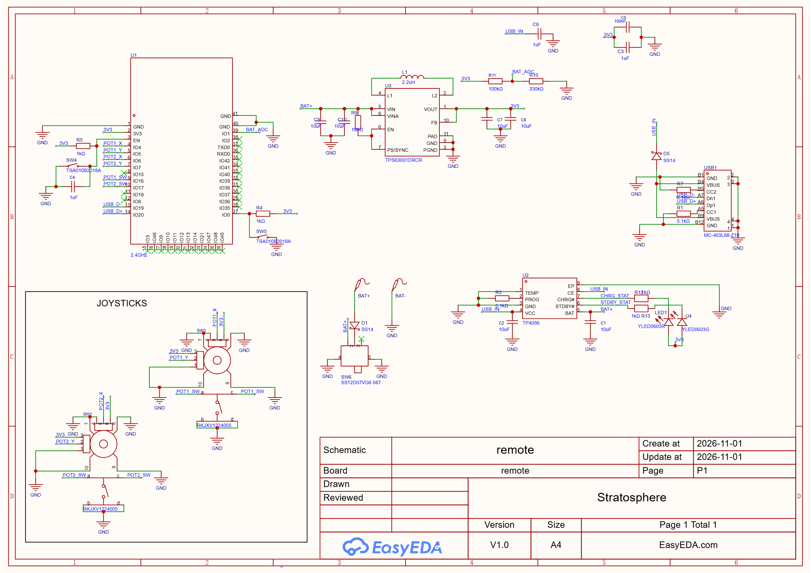
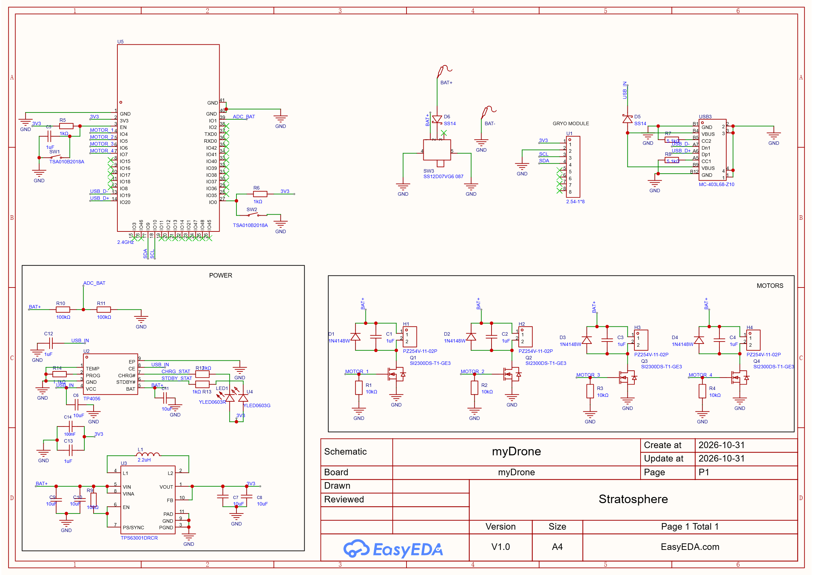
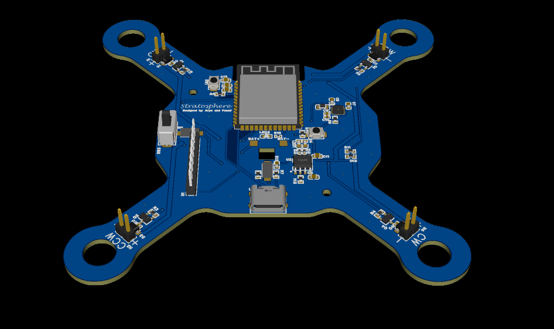
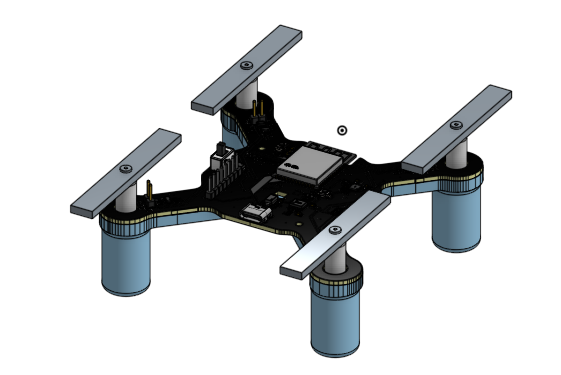
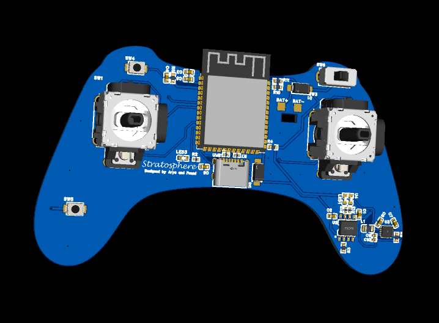
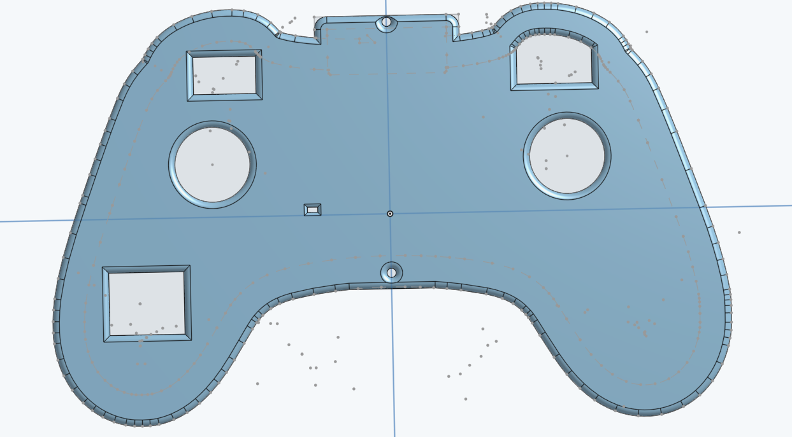

# Stratosphere

This is an esp32-powered drone, controlled by a remote!

# Key Features:

|Features|Model|
|-|-|
|Processor|ESP32-S3-WROOM-1-N16R8|
|Power Supply|Li-po Battery chargeable by USB-C|
|Communication/Data Transfer|ESP-now|
|LDO|TPS63020DSJR buck boost|
|Battery Charger|TP4056|
|Temperature + Humidity + Pressure sensor|BME280|
|Motors|4 brushed 720 motors|

## How to flash!

- plug your board using a usb-c cable
- hold the boot button down, press and release the reset button (whilc holding boot), then release boot!
- in arduino -> tools -> board -> esp32 -> esp32s3 dev module
- from usb-mode, select Hardware CDC and JTAG
- then enable usb cdc on boot
- click upload code (Arduino)
Do this for both the remote and the mainboard!

# PICTURES OF SCHEMATIC, PCB AND CAD

